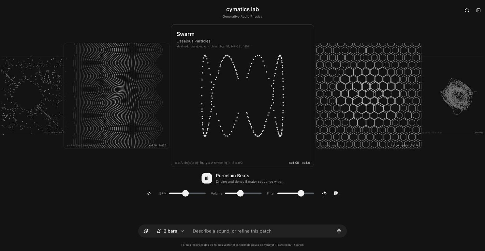
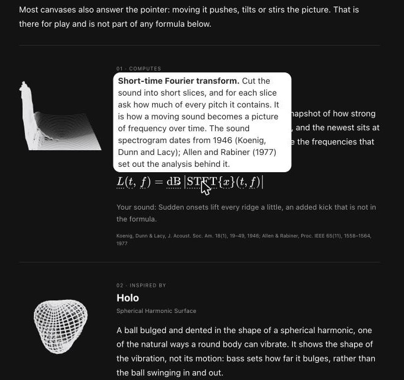
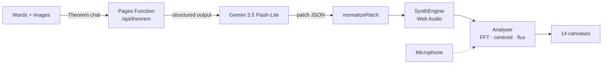

<div align="center">

# Cymatics Lab

**Describe a sound. Hear it. See it, drawn by real maths.**

You describe a sound in words or with an image, and Gemini writes it as a synth patch in JSON. The browser plays the patch, and fourteen canvases draw it live. Each canvas says how much of its picture is real physics.

[**Open the lab →**](https://cymatics.masudlewis.com) · [Read how it works](https://cymatics.masudlewis.com/why)

[](https://cymatics.masudlewis.com)
[](https://react.dev)
[](https://developer.mozilla.org/docs/Web/API/Web_Audio_API)
[](theorem/profile.ts)



</div>

## What it does

- **Write a sound in plain words.** Type "a slow acid line under glassy bells", or attach up to two images, and pick a loop length from 2 to 32 bars. Gemini returns a complete patch: tempo, swing, a lead and a bass, drums and effects. Ask again and it refines the patch in place.
- **Play it in the browser.** A small Web Audio synth plays the patch with no samples and no server.
- **Watch it in fourteen ways.** A spectrogram, a Lorenz attractor, a Tonnetz, a recurrence plot, Chladni patterns, Lissajous figures and others. The canvases read the live FFT, waveform, spectral centroid and spectral flux.
- **Know what is real.** Each canvas has one of four labels:

  | Label | Meaning |
  | --- | --- |
  | **Computes** | The picture is computed from the sound (Ridge, Phase, Recur, Vector, Lattice, Chaos). |
  | **Idealised** | Textbook physics in its ideal form, with the sound setting its inputs (Warp, Array, Twist, Swarm). |
  | **Inspired by** | Takes its form from real physics, but is not a model of it (Holo, Hive, Fluid). |
  | **Artistic** | Invented texture, moved by the sound (Strata). |

- **Listen to the room.** Turn on *Ambient sound* and the canvases follow your microphone instead of the synth.
- **Change any number.** Edit the patch JSON, save patches to the library, or start from a preset: Porcelain Beats, Sonic Run, Granular Clouds or Industrial Chaos.

## Read the maths



The [/why](https://cymatics.masudlewis.com/why) page tells the story of the project and shows the signal path, from your words to the patch to the speaker. Then it explains each canvas:

- The formula it draws. Hover any symbol in the formula to see what it means.
- What the sound changes in the picture, and anything in the picture that the formula does not include.
- The papers the formula comes from.

<br clear="right">

## The synth

A patch is plain JSON (see [`types.ts`](types.ts)). [`normalizePatch`](audio/patch.ts) clamps every value, and it migrates patches saved in the old single-sound format.

| Part | What it has |
| --- | --- |
| **Lead and bass** | One mono instrument each: seven waves (sine, square, saw, triangle, pulse, organ, bell), detune, FM with its own decay, a layered second oscillator, a sub-octave, level, glide and an LFO |
| **Filter** | Lowpass, highpass or bandpass. The slope is 12 dB, or 24 dB from two cascaded biquads. It has an envelope amount, and an accent that opens it on loud notes |
| **Notes** | Placed on a 16-step-per-bar grid, with velocity. 303-style `slide` notes bend into the next note without a new attack |
| **Drums** | Kick, snare, hat and clap, all synthesised |
| **Master** | Swing, drive, feedback delay, and reverb with a tone control |

## How it is built



| Layer | What runs it |
| --- | --- |
| UI | React 19, [Astryx](https://www.npmjs.com/package/@astryxdesign/core) components, KaTeX for formulas |
| Model | A [Theorem](https://www.npmjs.com/package/@theoremjs/agents) profile ([`theorem/profile.ts`](theorem/profile.ts)). A zod schema becomes the JSON schema that Gemini must fill |
| Server | One Cloudflare Pages Function ([`functions/api/theorem/[[path]].ts`](functions/api/theorem/%5B%5Bpath%5D%5D.ts)). Workers KV limits each browser to 10 patches and each IP address to 35 patches every week |
| Audio | Web Audio nodes in [`audio/SynthEngine.ts`](audio/SynthEngine.ts). Envelopes are in [`audio/envelope.ts`](audio/envelope.ts) |
| Visuals | 2D canvas, in [`simulations/logic.ts`](simulations/logic.ts) |

## Run it locally

You need Node 22 or later and a [Gemini API key](https://aistudio.google.com/apikey).

1. Put the key in `.dev.vars`. Git ignores this file.

   ```env
   GEMINI_API_KEY=your_key_here
   ```

2. Install the packages.

   ```bash
   npm install
   ```

3. Start the app. Vite rebuilds when you save, and Wrangler serves the build and the function.

   ```bash
   npm run dev
   ```

To limit generations, create your own KV namespace with `npx wrangler kv namespace create QUOTA`, and put its `id` in [`wrangler.toml`](wrangler.toml) in place of the one there. Without a `QUOTA` binding, the function does not count generations.

## Credits

The formulas, and the papers they come from, are cited on the [/why](https://cymatics.masudlewis.com/why) page.
